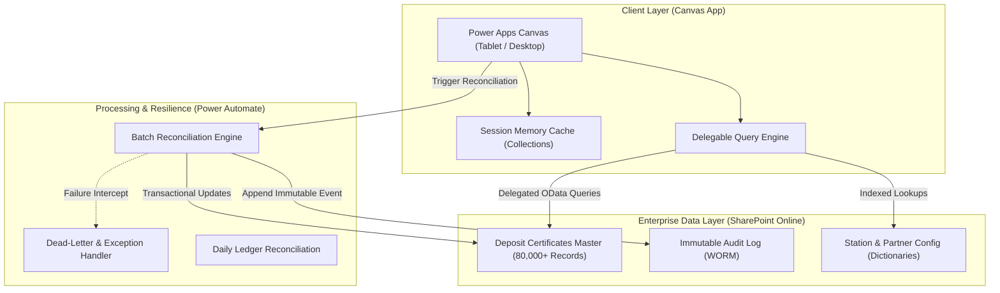
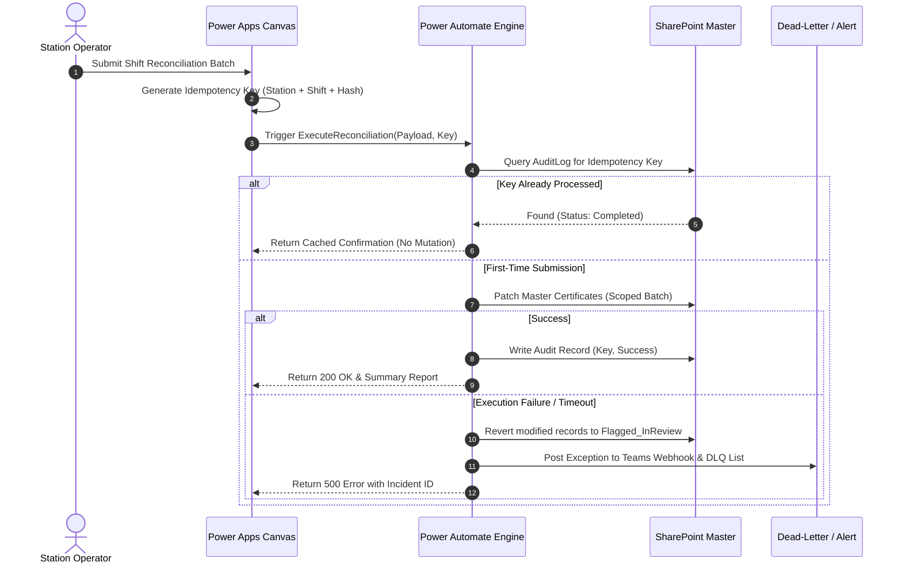

# System Architecture & Technical Design

This document details the architectural decisions, data modeling strategies, and resilience patterns governing the **Enterprise Supply Certificate & Deposit Management System**.

---

## 1. High-Level Architecture Overview

The system operates on an event-driven, hybrid architecture designed to deliver sub-second UI interactions across low-bandwidth commercial distribution points while maintaining full transactional consistency and audit compliance.

---

## 2. Architecture Decision Records (ADRs)

### ADR-001: Storage Tier Selection — SharePoint Online Lists with Column Indexing vs Microsoft Dataverse

* **Status:** Accepted & Verified in Production
* **Context:** The organization required managing 80,000+ deposit certificates across 120+ active field and commercial partner stations. Enterprise licencing constraints dictated evaluating standard Microsoft 365 E3/E5 capabilities versus rolling out Power Apps Premium per-user licenses ($20/user/month).
* **Decision:** Implement the master persistence layer using **SharePoint Online Lists with indexed columns**, custom partition keys, and strict query delegation boundaries rather than Dataverse.
* **Cost & Technical Impact:**
  * **Licensing OPEX Avoided:** ~$2,400 – $4,800/month across the operational user base.
  * **Trade-Off:** Lack of native relational constraints (foreign keys, cascading deletes, atomic ACID multi-table transactions) at the storage level.
  * **Mitigation:** Transaction boundaries, relational integrity, and cross-list lookups are enforced upstream within Power Apps business logic and downstream via idempotent Power Automate orchestrator flows.

---

### ADR-002: Mitigating the 2,000-Row Delegation Limit at Scale (80,000+ Records)

* **Status:** Accepted & Verified in Production
* **Context:** SharePoint Online enforces a 5,000-item List View Threshold and Power Apps imposes a non-delegable query ceiling (max 2,000 rows retrieved to client memory). Without architectural delegation mitigation, queries against 80,000+ items silently return truncated, invalid results.
* **Decision:**
  1. **Primary Indexing:** Applied indexed columns to `CertificateNumber`, `StationID`, `Status`, and `IssueDate`.
  2. **Server-Side Evaluation:** All filter expressions utilize strictly delegable comparison operators (`=`, `<>`, `>`, `<`). Non-delegable operators (`in`, text functions like `Mid`/`Left`, dynamic string searches) are prohibited in raw source queries.
  3. **Operational Working Sets:** User workflows operate on scoped status slices (e.g., `Status = "Active" And StationID = varCurrentStation`). Historical archived records are partitioned by issue year and accessed on demand.
  4. **Client Memory Boundary:** `ClearCollect` is reserved exclusively for static dictionary tables (< 500 items, e.g. partner stations, cylinder types) loaded once at `OnStart`.

---

### ADR-003: Idempotent Batch Reconciliation and Dead-Letter Architecture

* **Status:** Accepted & Verified in Production
* **Context:** High-volume shift-end batch settlements submitted by commercial partner stations can suffer intermittent network dropouts or duplicate clicks, risking double-reconciliation.
* **Decision:**
  * Implement an **Idempotency Key** generated at batch submission: `SHA256(StationID + ShiftDate + TotalCount + Checksum)`.
  * The reconciliation flow checks the unique hash in the `AuditLog` before processing. If the hash exists with status `Completed`, the workflow returns the existing receipt without mutating records.
  * In the event of a validation or network failure during mid-batch processing, execution routes to a **Dead-Letter scope** that rolls back partial statuses to `Flagged_InReview` and dispatches a Teams webhook alert to operations.

---

## 3. Failure Modes & Mitigations Matrix

| Failure Mode | Root Cause | Impact | Automated Recovery / Mitigation | SLA / Resolution |
| :--- | :--- | :--- | :--- | :--- |
| **5,000 List View Threshold Hit** | Unindexed column query or broad date range scan | App displays delegation warning; data truncated to 2,000 rows | Column indexes pre-configured; queries strictly scoped by `StationID` and `Status` | Immediate (< 1s query time preserved) |
| **Duplicate Batch Reconciliation** | Double-tap by operator under spotty 3G/LTE | Potential duplicate financial credit | Client button disabled upon click; flow verifies Idempotency Hash | 100% duplicate rejection rate |
| **Partial Transaction Failure** | Network timeout during 50-item status update | Desynchronized certificate states | Power Automate `Try-Catch` scope triggers compensatory rollback patch | Automatic recovery within 15s |
| **Concurrent Edit Collision** | Two operators updating same deposit voucher | Last-write-wins overwrite | Optimistic concurrency check via `@odata.etag` before commit | User prompted to refresh if etag mismatched |

---

## 4. Security & Compliance Architecture

* **Principle of Least Privilege (PoLP):** Field station operators are granted `Contribute` access restricted to item-level creation and editing of records originating from their assigned station code via custom SharePoint Permission Levels.
* **Audit Trail Immutability (WORM):** The `DepositAuditLog` list has write-only append permissions via a dedicated service account running cloud flows. UI operators and station leads cannot edit or purge audit records.
