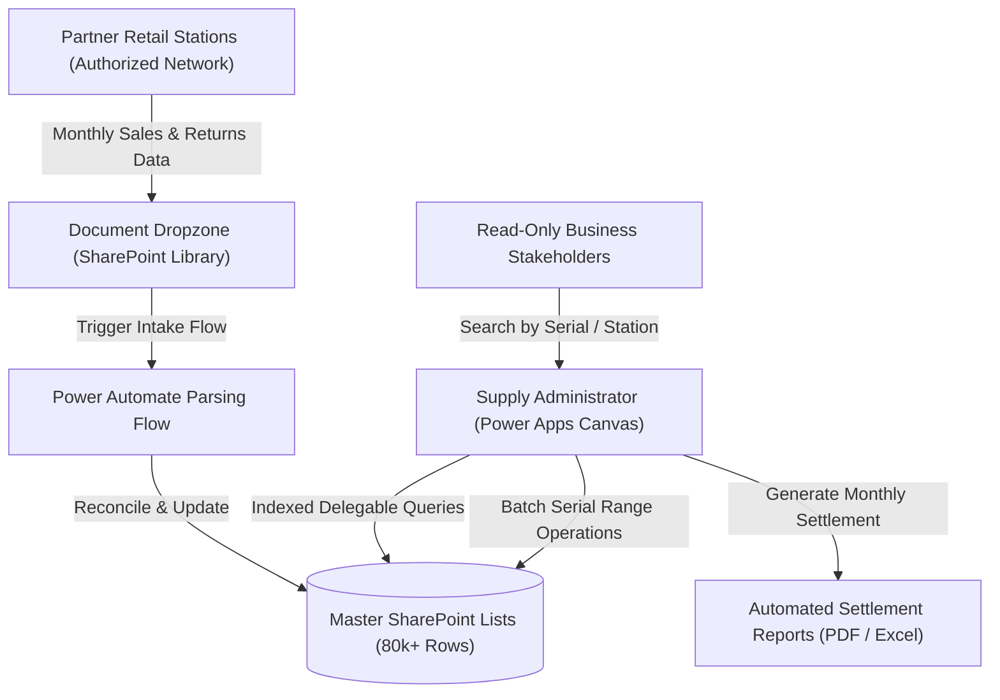

# Enterprise Supply Certificate & Deposit Management System

An enterprise Power Apps Canvas application and SharePoint Online master database architecture built to manage **80,000+ deposit certificates** across nationwide commercial distribution and retail partner networks - replacing a slow, error-prone legacy Excel system and eliminating a critical organizational Single Point of Failure (SPOF / bus factor = 1).

> **Portfolio note:** This repository is an architecture showcase and technical documentation. The production application operates within a private enterprise Microsoft 365 tenant. All company names, partner network identifiers, station addresses, and personnel details in this documentation have been sanitized and replaced with illustrative enterprise placeholders (*EnergyCorp Logistics / Partner Networks*).

---

## 🎯 Business Problem & Context

In the gas cylinder distribution industry, customers pay a refundable deposit upon obtaining a cylinder, documented by a unique serial certificate. When cylinders are returned, deposit reimbursements are settled against these certificates.

* **Legacy State:** The entire historical ledger (~70,000–80,000 rows across 19 columns) was maintained inside a monolithic Excel spreadsheet.
* **Pain Points:**
  - Severe performance degradation (minutes to open, frequent freezing and file locking conflicts).
  - High risk of data loss and corruption without transaction logging.
  - **Single Point of Failure (Bus Factor = 1):** Only one specific administrator knew how the calculations and macros functioned, making substitution impossible during absences.
  - Manual, tedious monthly reconciliation between partner station reports and internal ERP/SharePoint records.

---

## 💡 Solution Overview

A modern, cloud-native **Power Apps Canvas Master System** connected to an indexed **SharePoint Online list architecture**, automated with **Power Automate Cloud Flows**:



---

## ⚙️ Key Technical Challenges & Implementations

### 1. SharePoint Delegation Limit Workaround (>5,000 Item Threshold)
SharePoint Online lists enforce a strict 5,000-item query threshold. Querying a dataset of **80,000+ items** directly in Power Apps causes non-delegable query warnings and truncated data.

**Implemented Architecture:**
* **Indexed Column Hierarchy:** Created single and composite indexes on `Series`, `StatusCode`, `PartnerCode`, `DeliveryDate`, and `StationID`.
* **Server-Side Delegable Filters:** All primary gallery views execute strict delegable operators (`=`, `StartsWith`):
```powerfx
// Delegable filter leveraging indexed columns for 80k+ dataset
With(
    {
        TargetSeries: cmbSeriesFilter.Selected.Value,
        TargetStatus: cmbStatusFilter.Selected.Value,
        MinSerial: Value(txtSerialStart.Text),
        MaxSerial: Value(txtSerialEnd.Text)
    },
    Filter(
        'DepositCertificates_Master',
        Series = TargetSeries &&
        StatusCode = TargetStatus &&
        SerialNumber >= MinSerial &&
        SerialNumber <= MaxSerial
    )
)
```
* **Client-Side Virtualized Collections:** For multi-action batch transactions, data is fetched in segmented 2,000-record windows and aggregated into localized collections for instantaneous UI reactivity without re-querying SharePoint.

### 2. Batch Transaction Engine (Range Operations)
Administrators frequently dispatch or settle continuous blocks of certificates (e.g. `EEA 120000` to `EEA 120050`).
* The application calculates the range, checks the master list for existing collisions or duplicate allocations, and displays a pre-commit validation card (*"51 items valid, 0 collisions"*).
* Updates are pushed in atomic batches with a custom audit log entry written to `'Certificates_AuditLog'`.

### 3. Automated Reconciliation Matrix
* Imports structured monthly statements from retail partners.
* Automatically matches transactions against issued certificates, identifying:
  - Exact matches (automatically settled).
  - Unmatched serials (flagged for review).
  - Amount discrepancies (variance highlighted for accounting review).

---

## 📊 Data Schema Design

| List Name | Estimated Rows | Key Indexed Columns | Purpose |
|---|---|---|---|
| `DepositCertificates_Master` | ~80,000 | `Series`, `SerialNumber`, `StatusCode`, `StationID` | Master ledger of all active, returned, and voided certificates |
| `Deposit_Stations` | ~500 | `StationCode`, `PartnerNetwork`, `PostalCode` | Partner retail stations dictionary & email routing |
| `Deposit_MonthlySettlements` | ~1,200 | `PeriodYearMonth`, `PartnerNetwork`, `Status` | Balanced monthly settlement ledger |
| `Certificates_AuditLog` | Append-only | `CertificateID`, `ActionType`, `ModifiedBy`, `Timestamp` | Full compliance audit trail |

---

## 🚀 Business Impact

* **100% Elimination of Excel SPOF:** The entire workflow is now standardized; new team members can take over administration on day one without manual handover.
* **Zero Performance Latency:** Sub-second search across 80,000 records using indexed server-side delegation.
* **1.5h Daily Manual Work Saved:** Automated range updates and statement matching replaced cell-by-cell copy-pasting.

---

## 👨‍💻 Author
**Dawid Piotrowski**
* Role: IT Automation & Power Platform Developer
* LinkedIn: [linkedin.com/in/dawid-piotrowski0304](https://linkedin.com/in/dawid-piotrowski0304)
* GitHub: [github.com/Dawiddevops](https://github.com/Dawiddevops)
* Certification: Microsoft Certified: Power Platform Fundamentals (PL-900)
